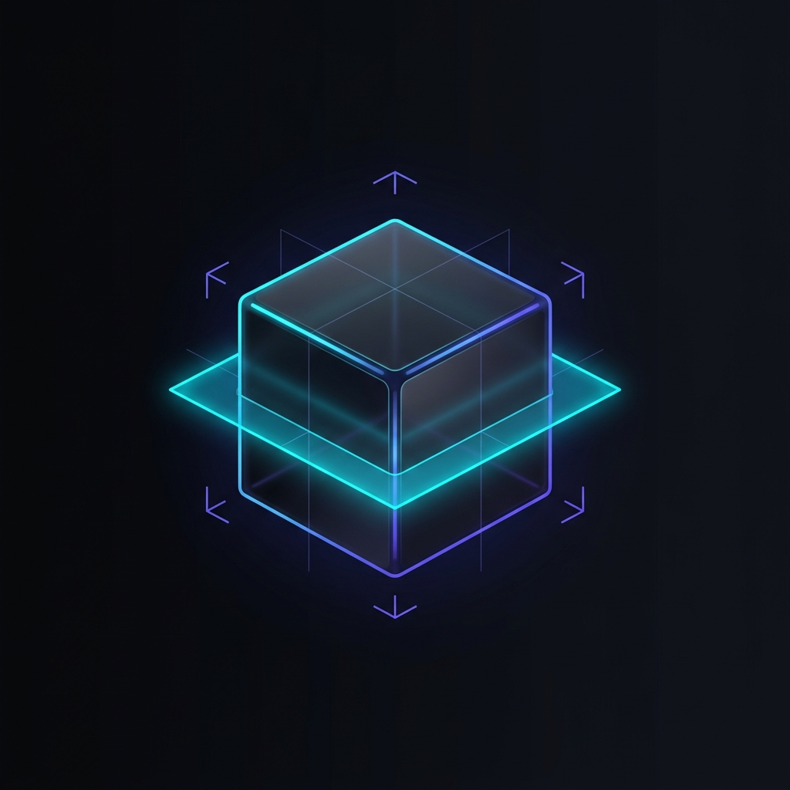

<div align="center">



# Inspectify

**AI-powered logistics packaging inspection and shipment intelligence platform**

[](https://reactnative.dev)
[](https://expo.dev)
[](https://typescriptlang.org)
[](https://supabase.com)
[](https://ultralytics.com)
[](https://deepmind.google/gemini)

</div>

---

## Overview

**Inspectify** is an enterprise-grade mobile application that uses a multi-layered AI stack — YOLOv8 object detection, Google Gemini Vision multimodal AI, and CatBoost gradient-boosted ML — to help logistics companies and individual sellers assess packaging quality, predict shipment damage risk, and optimise dispatch schedules.

The app serves two distinct user roles:

| Role | Purpose |
|------|---------|
| **Personal** | Individual sellers inspect packages, detect defects, and evaluate risk before dispatch |
| **Company** | Business accounts manage shipments end-to-end, with analytics, route intelligence, and dispatch optimisation |

---

## Screenshots & Features at a Glance

```
📦 Image QC          📹 Live Stream       🎬 Video Inspection
🧠 Risk Predictor    🗺️ Route Analytics   📅 Dispatch Optimizer
📊 Company Dashboard 🚚 Shipment Manager  📄 PDF Report Export
```

---

## Architecture

```
┌────────────────────────────────────────────────────────────────┐
│                     Inspectify Mobile App                      │
│                (React Native + Expo Router)                    │
└──────────────┬───────────────────────────────┬────────────────┘
               │                               │
   ┌───────────▼──────────┐       ┌────────────▼───────────┐
   │   AI Detection Layer │       │   Cloud Services Layer  │
   │                      │       │                        │
   │  • YOLOv8 Backend    │       │  • Supabase Auth & DB  │
   │    (FastAPI / Python)│       │  • Gemini Vision API   │
   │  • Gemini 2.5 Flash  │       │  • OpenRouter LLM      │
   │    (Vision fallback) │       │  • Open-Meteo Weather  │
   │  • CatBoost ML       │       │  • Nominatim Geocoding │
   └──────────────────────┘       └────────────────────────┘
```

### AI Stack

| Component | Technology | Purpose |
|-----------|-----------|---------|
| Object Detection | **YOLOv8** (custom-trained, `.pt`) | Box & packaging defect detection |
| Screen Defect | **YOLOv8** (second custom model) | Screen scratch / crack detection |
| Vision Fallback | **Google Gemini 2.5 Flash** | Multimodal image analysis when backend unavailable |
| Risk Prediction | **CatBoost Gradient Boosting** | End-to-end shipment damage risk scoring |
| Dispatch Intelligence | **Gemini + OpenRouter LLM** | Corridor analysis & departure window AI |
| Weather | **Open-Meteo API** | 7-day forecast for route risk scoring |
| Geocoding | **Nominatim (OpenStreetMap)** | Origin/destination coordinate lookup |

---

## Features

### 🔍 Image Quality Control (Personal)

- **Dual-engine inspection** — tries YOLOv8 backend (3.5 s timeout), automatically falls back to Gemini Vision AI
- **Package defect detection** — detects dents, tears, crush damage, punctures on external packaging
- **Screen defect detection** — dedicated model for detecting cracks and scratches on device screens
- **Parcel Risk Evaluator** — toggle-activated within the QC tab; uses defect output to classify parcel as *Intact* or *Damaged* via CatBoost
- Confidence score overlays with annotated bounding boxes

### 📹 Live Stream Inspection

- Real-time camera feed processed at ~3.5 s intervals
- Streams frames to YOLOv8 backend via `/api/live-stream/frame`
- Live defect overlay with bounding boxes and confidence labels
- Snapshot capture of defective frames

### 🎬 Video Inspection

- Upload full MP4/MOV video for async frame-by-frame YOLO inspection
- Configurable extraction FPS
- Annotated video output + per-defect timestamps
- Real-time progress tracking via polling

### 🧠 Shipment Risk Predictor (Personal)

Full CatBoost ML pipeline with 25+ input features:

| Category | Features |
|----------|---------|
| Logistics | Transport mode, carrier, distance, transit hours |
| Package | Type, weight, dimensions, material, cushioning |
| Handling | Conditions, fragile flag, handling events |
| Weather | Temperature (mean/max/min), humidity, precipitation, wind |
| Mode-specific | Stops, vibration level, altitude risk, port handlings |

Returns a **damage risk probability** (0–100 %) with an `Intact` / `Damaged` verdict, alongside a full confidence breakdown.

### 🗺️ Route Analytics (Company)

- Origin & destination with **geolocation autocomplete**
- **Calendar date picker** — select planned dispatch date visually
- 7-day weather corridor fetched from Open-Meteo for the full route
- CatBoost risk scores for each day around the planned date
- Departure window comparison (Early Morning → Overnight)
- **PDF report export** — full analytics report shareable via email or file share

### 📅 Dispatch Window Optimizer (Company)

- Select planned shipping date via interactive **CalendarDatePickerModal**
- Transport mode selection (Road / Air / Sea / Rail) with mode-specific configuration
- Recommended dispatch windows with risk scores for ±3 days around planned date
- **LLM-powered AI insights** via Gemini / OpenRouter:
  - Traffic corridor analysis
  - Selected vs. recommended departure verdict
  - Actionable logistics recommendations
  - Confidence score

### 📊 Company Dashboard

- Shipment KPI cards (total, in-transit, delivered, flagged)
- Recent shipments feed with status badges
- Quick navigation to Shipments, Analytics, and Dispatch tools

### 🚚 Shipment Manager (Company)

- Full shipment CRUD with Supabase persistence
- New shipment creation wizard with package details, carrier, route
- Shipment detail view with **traceability modal**
- Filter and search across all shipments

### ⚙️ Settings

- Switch between YOLOv8 models (`best` / `latest`)
- Adjust confidence thresholds per model independently
- Dark / Light mode toggle
- Profile management

---

## Tech Stack

### Mobile App

| Layer | Library / Version |
|-------|--------------------|
| Framework | React Native 0.88.1 |
| Navigation | Expo Router 58 (file-based) |
| UI Styling | NativeWind 4 (Tailwind CSS for RN) |
| Auth | Supabase Auth + AsyncStorage session persistence |
| State | React hooks + Context API (`AuthContext`) |
| Icons | Expo Vector Icons (Ionicons, MaterialCommunityIcons, FontAwesome5), Lucide RN |
| Animations | React Native Reanimated 4 |
| Gestures | React Native Gesture Handler 3 |
| Camera | Expo Camera |
| Image Picker | Expo Image Picker |
| Location | Expo Location |
| File System | Expo File System |
| PDF | Expo Print + Expo Sharing |
| Email | Expo Mail Composer |
| Video | Expo Video |

### Backend (separate server, not in this repo)

| Component | Technology |
|-----------|-----------|
| API Server | FastAPI (Python) |
| Defect Detection | YOLOv8 (Ultralytics) |
| Risk ML | CatBoost |
| Transport | Uvicorn |
| Endpoints | `/api/live-stream/frame`, `/api/video-inspection/*`, `/api/predict/*` |

### Cloud & External APIs

| Service | Usage |
|---------|-------|
| **Supabase** | Authentication, shipment database, real-time |
| **Google Gemini 2.5 Flash** | Vision AI for image QC fallback + dispatch intelligence |
| **OpenRouter** | Alternative LLM routing for dispatch insights |
| **Open-Meteo** | Free 7-day weather forecast (no API key required) |
| **Nominatim** | Reverse + forward geocoding (OpenStreetMap) |

---

## Project Structure

```
yolo_mobile_app/
├── src/
│   ├── app/
│   │   ├── (tabs)/                   # Personal account screens
│   │   │   ├── index.tsx             # Home screen
│   │   │   ├── image-inspect.tsx     # Image QC tab
│   │   │   ├── live-stream.tsx       # Live camera inspection
│   │   │   ├── live-video.tsx        # Live video view
│   │   │   ├── video-inspection.tsx  # Video upload inspection
│   │   │   ├── screen-scratch.tsx    # Screen defect detection
│   │   │   ├── settings.tsx          # App settings
│   │   │   ├── guide.tsx             # User guide
│   │   │   └── support-beta.tsx      # Support & beta features
│   │   ├── company/                  # Company account screens
│   │   │   ├── dashboard.tsx         # KPI dashboard
│   │   │   ├── shipments.tsx         # Shipment list
│   │   │   ├── new-shipment.tsx      # Create shipment
│   │   │   ├── shipment-detail.tsx   # Shipment details & traceability
│   │   │   ├── analytics.tsx         # Route analytics + risk scoring
│   │   │   └── dispatch.tsx          # Dispatch window optimizer
│   │   ├── auth/
│   │   │   ├── login.tsx             # Login screen
│   │   │   └── register.tsx          # Registration screen
│   │   ├── predict.tsx               # Standalone risk predictor
│   │   └── _layout.tsx               # Root layout + auth guard
│   ├── components/
│   │   ├── CalendarDatePickerModal.tsx  # Pure-RN calendar date picker
│   │   ├── LocationSearchInput.tsx      # Geolocation autocomplete
│   │   ├── ShipmentTraceabilityModal.tsx
│   │   ├── ThemeToggle.tsx
│   │   └── ...
│   ├── services/
│   │   ├── geminiVision.ts           # Gemini Vision API client
│   │   ├── catboostPredictor.ts      # CatBoost ML API client
│   │   ├── dispatchAiService.ts      # LLM dispatch intelligence
│   │   ├── liveStreamApi.ts          # Live frame streaming API
│   │   ├── videoInspectionApi.ts     # Video upload & polling API
│   │   ├── supabaseClient.ts         # Supabase JS client
│   │   └── supabaseAdmin.ts          # Supabase admin client
│   ├── utils/
│   │   ├── pdfReportGenerator.ts     # PDF export utility
│   │   ├── shipmentStorage.ts        # AsyncStorage shipment cache
│   │   ├── scanStorage.ts            # Scan history persistence
│   │   ├── modelStorage.ts           # Active YOLO model preference
│   │   ├── confidenceStorage.ts      # Confidence threshold settings
│   │   └── profileStorage.ts         # User profile cache
│   ├── contexts/
│   │   └── AuthContext.tsx           # Auth state + role management
│   └── constants/
│       ├── api.ts                    # Backend URL resolver
│       ├── brandDirectory.ts         # Brand support lookup
│       └── theme.ts                  # Design tokens
├── Inspectify_ML_Artifacts/          # ML model training artifacts
│   ├── models/
│   ├── output/
│   └── raw/
├── best.pt                           # Primary YOLOv8 packaging defect model
├── latest_model_defect.pt            # Latest retrained defect model
├── screen_scratch_model.pt           # Screen defect detection model
├── app.json                          # Expo app config
├── package.json
├── tsconfig.json
├── tailwind.config.js
└── metro.config.js
```

---

## Getting Started

### Prerequisites

- **Node.js** 18+ and npm
- **Expo CLI** (`npm install -g expo-cli`)
- **Expo Go** app on your phone, or an Android/iOS simulator
- Python 3.10+ with the FastAPI backend running (see [Backend Setup](#backend-setup))

### 1. Clone the repository

```bash
git clone https://github.com/Vickyxsg173/Inspectify.git
cd Inspectify/yolo_mobile_app
```

### 2. Install dependencies

```bash
npm install
```

### 3. Configure environment variables

Create a `.env` file in the project root:

```env
# Your local machine IP (replace with your actual LAN IP)
EXPO_PUBLIC_HOST_IP=192.168.x.x

# Google Gemini API key
EXPO_PUBLIC_GEMINI_API_KEY=your_gemini_api_key_here

# OpenRouter API key (for dispatch LLM — optional, falls back to Gemini)
EXPO_PUBLIC_OPENROUTER_KEY=your_openrouter_key_here

# Supabase
EXPO_PUBLIC_SUPABASE_URL=https://your-project.supabase.co
EXPO_PUBLIC_SUPABASE_ANON_KEY=your_supabase_anon_key
```

### 4. Start the Expo dev server

```bash
npm start
# or for a specific platform:
npm run android
npm run ios
```

Scan the QR code with **Expo Go** on your phone (must be on the same LAN as your dev machine).

---

## Backend Setup

The FastAPI backend serves the YOLOv8 and CatBoost models. It is expected to run at `http://<your-ip>:8000`.

> **Note:** The backend source is in a separate repository / directory. Ensure it is running before using the app's detection and prediction features.

### Key endpoints

| Method | Endpoint | Description |
|--------|---------|-------------|
| `POST` | `/api/live-stream/frame` | Process a single Base64 camera frame |
| `POST` | `/api/video-inspection/upload` | Upload video for async inspection |
| `GET` | `/api/video-inspection/status/{id}` | Poll inspection progress |
| `GET` | `/api/video-inspection/results/{id}` | Fetch completed results |
| `POST` | `/api/predict` | CatBoost risk prediction |

---

## ML Models

| File | Model | Purpose | Input |
|------|-------|---------|-------|
| `best.pt` | YOLOv8 Custom | Packaging defect detection | RGB image |
| `latest_model_defect.pt` | YOLOv8 Retrained | Updated defect detection | RGB image |
| `screen_scratch_model.pt` | YOLOv8 Custom | Screen scratch / crack detection | RGB image |

### Defect Categories Detected

- Dent / Crush damage
- Tear / Puncture
- Corner damage
- Moisture damage
- Label damage
- Screen crack / scratch

---

## CalendarDatePickerModal

A fully **pure React Native** calendar component (zero native dependencies) used throughout the app for date selection. It works immediately on any existing APK build without requiring a new native build.

**Features:**
- Month / year navigation with `<` / `>` arrows
- Weekday headers (Su Mo Tu We Th Fr Sa)
- Past dates disabled
- Inspectify brand red `#FF2D55` selection highlight
- Today highlighted with a subtle accent
- Quick shortcut chips: **Today**, **Tomorrow**, **+2D**, **+3D**, **+5D**, **+7D**

---

## User Roles & Account Types

### Personal Account
- Image QC with dual-engine defect detection
- Live stream inspection
- Video inspection
- Screen defect detection
- Shipment risk predictor (with calendar date picker)
- Scan history and PDF report

### Company Account
- All Personal features, plus:
- KPI Dashboard (shipment overview)
- Full shipment lifecycle management (CRUD)
- Route Analytics with 7-day weather risk scoring
- Dispatch Window Optimizer with LLM AI insights
- PDF risk report export
- Shipment traceability modal

---

## Security & Privacy

- Camera, photo library, and location permissions declared in `app.json` with user-facing descriptions
- Supabase row-level security (RLS) for per-user data isolation
- No encryption exemption (`ITSAppUsesNonExemptEncryption: false`) for App Store compliance
- API keys are loaded from environment variables only — never committed to git

---

## Build & Deployment

This project uses **EAS Build** (Expo Application Services) for production APK/IPA generation.

```bash
# Install EAS CLI
npm install -g eas-cli

# Configure
eas build:configure

# Build Android APK (internal distribution)
eas build --platform android --profile preview

# Build iOS (requires Apple Developer account)
eas build --platform ios --profile preview
```

> **EAS Project ID:** `9754134d-d397-4b22-aba5-ca41848b4cf6`

---

## Contributing

1. Fork the repository
2. Create a feature branch: `git checkout -b feat/your-feature`
3. Commit your changes: `git commit -m "feat: add your feature"`
4. Push to the branch: `git push origin feat/your-feature`
5. Open a Pull Request

---

## License

This project is proprietary software. All rights reserved.

---

<div align="center">

Built with ❤️ using **React Native**, **Expo**, **YOLOv8**, **Google Gemini**, and **CatBoost**

</div>
